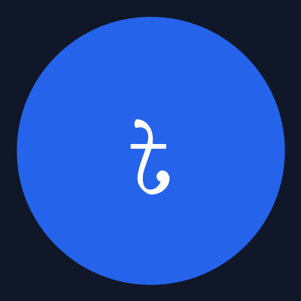

# price_weight_cal
A clean, responsive calculator for converting between price and weight using Bangladeshi Taka (৳).



## ✨ Features

- **Calculate by Price** — Enter the price per kilogram and your budget to find the available weight in grams.
- **Calculate by Weight** — Enter the price per kilogram and quantity in grams to calculate the total cost.
- Bangladeshi Taka (৳) currency support.
- Real-time calculation results.
- Responsive design for desktop and mobile devices.
- Helpful tab information modal.
- Accessible tab controls and live result updates.
- Reduced-motion support for animations.

## 🧮 How It Works

### Calculate by Price

```text
Weight (g) = (Amount to spend / Price per kg) × 1000
```

Example: If the price is ৳400/kg and you spend ৳100, the calculator returns 250 g.

### Calculate by Weight

```text
Cost (৳) = (Weight in grams / 1000) × Price per kg
```

Example: If the price is ৳400/kg and the weight is 250 g, the calculator returns ৳100.

## 🛠️ Technology

- HTML5
- CSS3
- Vanilla JavaScript
- No external dependencies

## 📁 Project Structure

```text
price-per-weight/
├── README.md
└── site/
    ├── favicon.png
    ├── index.html
    ├── script.js
    └── styles.css
```

## 🚀 Run Locally

### Option 1: Open directly

Open `site/index.html` in a modern web browser.

### Option 2: Use a local server

From the project directory, run:

```bash
npx serve site
```

Then open the URL printed in your terminal, usually `http://localhost:3000`.

## 🌐 Deploy

This project can be deployed to Netlify, GitHub Pages, Vercel, or Cloudflare Pages.

For Netlify or Vercel:

1. Upload or connect the project repository.
2. Set the publish/deployment directory to `site`.
3. Leave the build command empty because this is a static project.

## 🔒 Input Rules

- Negative values are ignored.
- A price of zero hides the result.
- An amount or weight of zero hides the result.
- Results are rounded to up to two decimal places.

## 👤 Author

Made with ❤️ by **Rakib**

## 📄 License

This project is available for personal and educational use.
